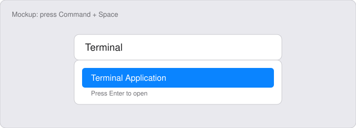
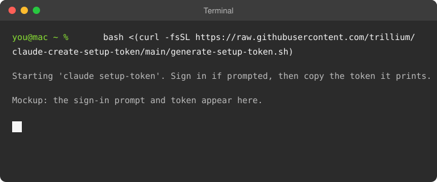

# claude-create-setup-token

A small script that runs `claude setup-token` to generate a long-lived Claude Code
authentication token for your subscription.

## Run it

Open Terminal, paste this command, and press `Enter`:

```sh
# Downloads the script from GitHub and runs it in one step.
#   curl -fsSL   fetch the script; -f fails on HTTP errors, -s hides progress,
#                -S still shows errors, -L follows redirects.
#   <( ... )     hand the script to bash as a file rather than a pipe, so stdin
#                stays on your terminal and the sign-in prompt works.
#   bash         checks that `claude` is on your PATH, runs `claude setup-token`,
#                then prints where to store the token.
bash <(curl -fsSL https://raw.githubusercontent.com/trillium/claude-create-setup-token/main/generate-setup-token.sh)
```

## Step by step

<details>
<summary>How to open the Terminal app</summary>

Press `Command` + `Space`, type `Terminal`, and press `Enter`.



</details>

<details>
<summary>How to paste the command into Terminal</summary>

Click in the Terminal window, paste with `Command` + `V`, and press `Enter`.



</details>

<details>
<summary>Sign in to Claude</summary>

Follow the prompts in Terminal to sign in.

</details>

<details>
<summary>Keep the token</summary>

Copy the token Terminal prints and store it somewhere private.

</details>

Requires Claude Code on your PATH. The script does not store the token. Copy it from the
output and keep it somewhere private, such as your shell profile or a password manager.

Or clone and run it locally:

```sh
./generate-setup-token.sh
```
